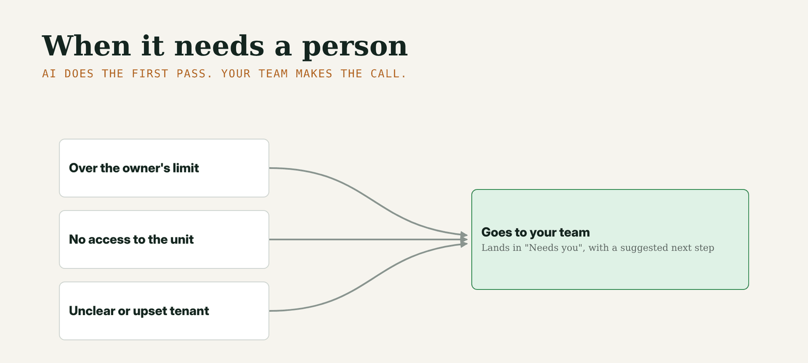

Every property manager knows the call. A tenant says it is urgent, someone on your team drops what they are doing, and it turns out the fix was a filter, a breaker or a door that was not latched.

In my company I noticed we spent a lot of time picking up phone calls for things that were not that important. Tenants calling something urgent does not mean it is an emergency, and plenty of issues can be sorted over the phone with a basic diagnosis. That is work AI can handle, as long as it knows your process.

So I tested it the honest way. I called my own maintenance line as a tenant, twice, and let the AI agent handle it.

## How the AI handles a tenant call

Tenants reach us three ways: the portal, a text message, and now a phone call. No matter which door they use, the request lands in the same place and runs through the same steps.

The part that makes it work is not the AI. It is the diagnosis guides. We wrote one for every situation my team deals with on a regular basis: what to check first, what to ask next, and when to stop and send a person. Without that, the AI is guessing. With it, the AI follows the same path my best coordinator would.

## Call 1: a calm tenant with a broken dishwasher

I called in and said my dishwasher had stopped working. Here is what the agent did, in order:

1. **It confirmed who I was and where I live.** It asked for my name and address, found me on file and saw there was already an open request on the unit. It asked whether the dishwasher was the same issue or something new.
2. **It troubleshot like a coordinator.** Are the lights on the control panel on? Is the door latching all the way? Is the filter at the bottom full of food? Is the kitchen sink draining normally?
3. **It caught the real problem.** When I said the sink was not draining and smelled like sewage, it stopped troubleshooting. It told me to stop running water in the kitchen, keep the dishwasher and sink out of use, and keep kids and pets away. Then it said our on-duty person had been alerted and would call me back.

When I asked when to expect the call, it did not make up a time. It said it could not give an exact time and the on-duty person would call as soon as possible. That matters. An AI that promises a time your team cannot keep creates a second complaint.

It turned "my dishwasher is broken" into a drain backup without anyone on my team picking up the phone.

## Call 2: a pushy tenant who wants a human

For the second call I reported a garage door that moved partway and stopped, and I was not nice about it. I told it I did not want to talk to an AI and wanted a technician.

- **It did not argue.** It said that was totally fair and that it would get my details down so the right person could call me back.
- **It still got the job details.** Is the light on the opener on? Are the two small sensors near the floor on, and is anything blocking them?
- **It knew when to stop.** I said I thought it was the springs, and it misheard me as "screen." After two tries it skipped the question instead of looping, because we do not want to frustrate a tenant further. It told me not to keep running the opener or push the door, and flagged the job for our on-duty person.
- **It passed along what mattered to me.** When I said I needed to leave for work, it flagged that too, and suggested I keep my phone on and nearby.

It was not perfect. It missed one word. But it stayed calm, never got defensive and still handed my team a complete job.

## What happens after the call

By the time I hung up, the work was already moving:

- **The job was open** with the recording and the full transcript, so my team can hear exactly what the tenant said.
- **The tenant got a text** confirming the request was received.
- **The vendor was contacted** with the issue and the fact that the tenant asked to speak to a person.
- **My team's view showed every step** the system took: it opened the job from the call, created the task in our property management software and suggested a plumber.

Then it waits. The suggested vendor sits there until a person on my team approves it. I can approve it, correct it or tell the system what to do instead, all from the team chat.

## Keep a human in the loop until you trust it

If you are new to AI, this is the first thing I would set up. Let the AI do the first pass, but have a person approve the step before anything goes out. Every approval or correction also trains the system, so over time you trust it more. Once a step has earned your trust, you can move it to fully automated.

Owner approvals work the same way. You set a spending limit, and anything over it gets flagged. If you are the kind of property manager who always gets the owner's go-ahead first, set the limit to zero for all properties and every request will flag you to get approval before a vendor is dispatched. That keeps you from paying for a repair out of your own pocket.

## The real job: write your process down first

If you take one thing from this, it is that the AI is only as good as the process you give it. Map every stage of a maintenance request, from how it comes in to how it closes out, and write a diagnosis guide for the situations your team sees every week. That is the work that lets an AI agent handle the call the way your team would.

Then imagine every call handled this way. The information is gathered, the tenant knows what is happening and the vendor coordination has started. By the time a property manager steps in, it does not take much of their time anymore.

## More call scenarios

- [No hot water, then a gas smell: how the AI troubleshoots a water heater and handles a gas emergency](/blog/no-hot-water-tenant-call)

## FAQ

### What happens if a tenant calls with a real emergency?

The AI gives the tenant safety steps right away, like stopping the water or staying away from the area, and alerts the on-duty person. In our process, an emergency gets a vendor sent within 15 minutes. Routine repairs are booked at least 24 hours out so the tenant gets proper notice of entry.

### Can I build an AI maintenance line myself?

You can. It is not a weekend project. Plan on one to two months to build it yourself, and most of that time goes into the diagnosis guides and the rules for when to hand off to a person, not the AI itself. The upside of building it yourself is no subscription. The downside is that you maintain it.

### Does it work with my property management software?

Acel Cortex works on top of the software you already use, including Buildium, AppFolio, Rentvine and Rent Manager, with no migration. Jobs from the phone, text and portal all land on the same card, and tasks are created in your property management software.

### Is the AI phone agent available now?

It is built and running in our own 800-unit company, which is how we test everything before clients get it. Maintenance triage is one of the next tools we are rolling out. If you want to see it on your own maintenance workflow, book a call and I will walk you through it.
