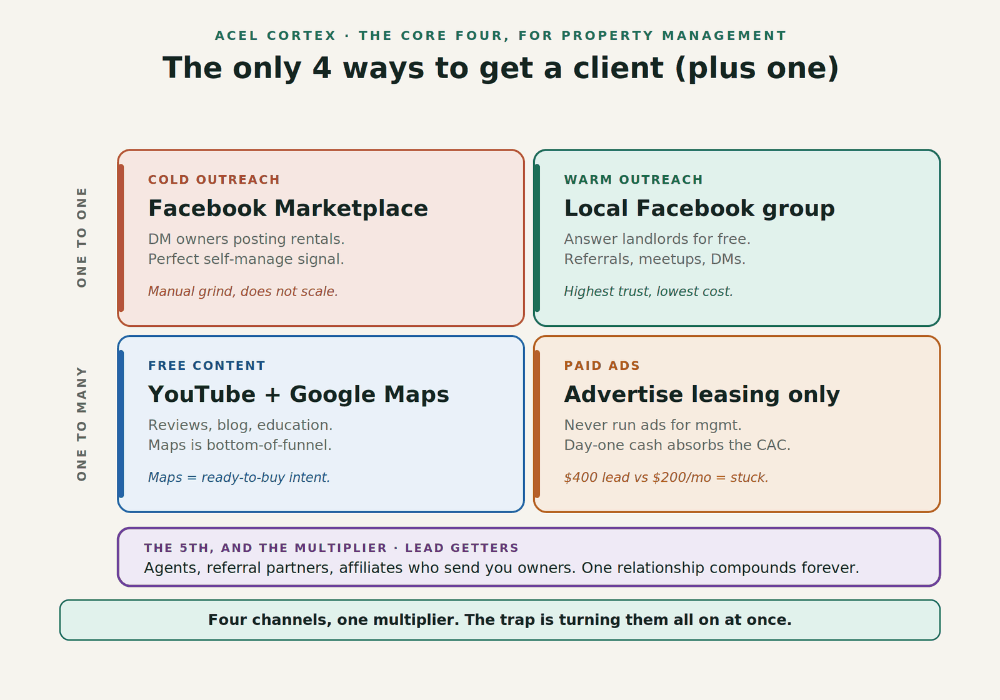

If you are not getting as many owner clients as you want, it is usually because you are not generating as many leads as you need. Alex Hormozi's *$100M Leads* says there are only four ways to get leads, and everything else is a variation. Here is how each one works in a real property management company. We manage over 800 units, and we have used all four.

Two of the channels are one to one (a private conversation with one owner). The other two are one to many (one piece of content or one ad reaching lots of owners).

## 1. Cold outreach: start here if you have no budget

This is how I started in 2016, before I had a property management company. I had student rentals near McMaster University and could not find a property manager, so I figured other landlords had the same problem. I went to the off-campus listing site where landlords posted units and started contacting them one by one.

Today it is even easier. Open Facebook Marketplace, go to property rentals and look at the area you want to manage. Every landlord posting there either has a vacancy or one coming, which means they are losing money. That is your opening.

The listings I look for:

- Owners who are clearly out of town.
- Listings with poor photos, which get less interest from tenants.

Send 100 messages a day for 30 to 60 days straight and you will get leads. It takes effort, not money, which is why it works when you are starting out.

## 2. Warm outreach: follow up and give value

Cold outreach creates a lot of contacts. Some owners will say "check back in a month." Those are now warm leads, and the job is to stay in touch without pitching every time.

Give things away. People value what you give them, and they are more willing to listen once you have helped them. Two ways to do it at scale:

- **An email list**, so one email reaches every owner you have talked to.
- **A community.** We run a Facebook group of about 20,000 members that connects landlords and tenants. Landlords can advertise units, tenants find places, and the group is clearly run by our property management company with our phone line on it.

## 3. Free content: the channel that keeps paying

A lot of property managers are afraid to put themselves out there. We deal with disputes and put out fires for owners, so being public feels risky. I felt that too.

My fix was to separate the audiences. I created a separate brand for landlords and investors that taught how to invest, deal with tenants and stay compliant with the Landlord and Tenant Board in Ontario. The best performing videos were the practical ones, like the duties of a property manager and how to serve specific notices. Tenants only knew the property management company, so there was no blowback.

Your website matters here too. Most owners do not look for a property manager until they have a problem, and when they do, they search with their city name, often on Google Maps. You need to show up. Every video we make becomes a blog post on our site, and that content keeps getting found long after it is published. It also helps you show up in AI search, where owners increasingly ask ChatGPT or Google's AI for a recommendation.

## 4. Paid ads: sell leasing first

Property management margins are tight, so paid ads scare people. In my experience it costs about **$400 to $500 to win one client** through ads, and sometimes $700, $800 or even $1,000 without a sale. A management contract alone may never earn that back.

The way to make ads work is to sell leasing (tenant placement) first, because it pays upfront. If average rent in your city is $3,000 and your leasing fee is 75 percent of a month's rent, that is **$2,250 per lease**. At $1,000 of ad spend per lease, you make 2.25 times your money. Get the cost down to $500 and it is closer to 4.5 times. Do the math carefully before you spend, or it is easy to burn money.

Paid ads are not only Google and Meta. Paying to attend a room full of investors, like a mastermind or a local event, is also a paid channel, and those rooms are full of high-intent owners.

## The multiplier: lead getters

The last idea in the book is lead getters: people who bring you leads. One lead getter who sends you five leads is good. Five of them send you 25.

In property management, the best lead getters are realtors and mortgage brokers who work with investors. They already have your future clients, and many do not want to deal with property management after the deal closes. Track how many investor-focused agents you have a real relationship with, and aim to be the property manager on their preferred list.

## FAQ

### Which lead channel is cheapest for a new property management company?

Cold outreach. It costs time instead of money. Contacting landlords with active listings on Facebook Marketplace, 100 a day for 30 to 60 days, is enough to land your first clients without a marketing budget.

### Should I advertise under my property management company's name?

Not necessarily. Tenants see your company name every day, so landlord-focused content under the same name can attract tenant complaints. A separate brand for investor education keeps the two audiences apart.

### How do I get realtors to refer owners to me?

Make their job easier first. Be the reliable property manager their investor clients can hand off to after closing, so the agent gets the commission without having to deal with property management. Track how many investor-focused agents you have a real relationship with and grow that number every month.
