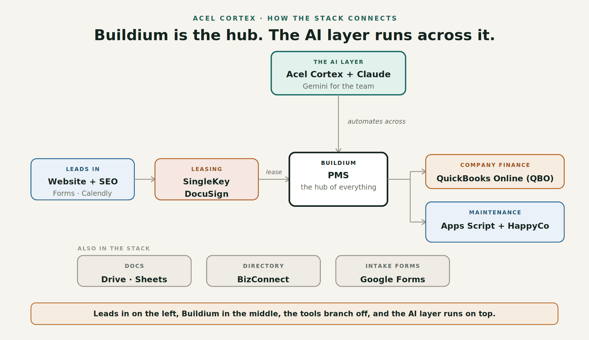

I used to think I needed expensive, advanced tools to beat my competition. In reality, I only need a handful. Here is everything we use to run our 800-unit property management company, where I cut subscriptions, and how **Acel Cortex**, the AI company I built, connects all of it.

## The AI layer: Claude and Acel Cortex

Two AI tools sit on top of everything else:

- **Claude** is my new Google. I ask it everything, and it does not just give me information, it gets work done.
- **Acel Cortex** is the software company I built to run the work inside our own property management company. It connects the tools below and does the work between them, the kind of work that used to need another employee.

Keep that in mind as you read the stack. At the end I will show you exactly how **Acel Cortex** ties it together.

## The foundation: your property management software

Your property management software is the hub. It holds tenants, owners, ledgers and owner draws. We use Buildium, and every owner charge goes onto the owner's statement there so the trust account money is tracked in one place. A bookkeeper reconciles it every month.

Honestly, which software you pick matters less than one thing: **is it AI friendly?** That means it has an API with write access, so other tools and AI can read and update it. Buildium is good. AppFolio is good but gets expensive at the tier you need. Rent Manager is another solid option.

Be careful with smaller platforms. If there is no API, you will pay for it later as you scale, unless you plan to stay around 20 to 50 doors.

## Getting found: website and Google

- **Website on WordPress.** Simple, and any good WordPress designer can build it. Include a blog for search traffic, plus clear links to the tenant and owner portals so all your traffic flows through your site.
- **Google Business Profile.** Owners searching for a property manager want someone close by who can handle emergencies fast, so showing up on Google Maps is a big deal.

## Leasing: two tools

- **SingleKey** for applications. Even though we collect initial details in our property management software, we have applicants apply through SingleKey so we can see credit reports and their current situation.
- **DocuSign** for leases. Our property management software has e-signing, but a lot of our business is student rentals and DocuSign gives us much more flexibility. It is expensive, and worth it for us.

## Running the operation: Google Workspace

I used to spend a lot on advanced tools for tracking leasing and operations. They looked better, but a spreadsheet was easier: we can customize it, it is internal so it does not need to look pretty, and it is one less login. We run most of the operation on **Google Sheets, Drive, Docs and Forms**.

One example: technicians fill out a Google Form after every job, before they drive to the next one. A script then copies each entry from the master sheet into that technician's own sheet so they can see what has been done, approved and paid. It is the best timesheet I could ask for, because I know exactly which hours are billable.

## Phones: protect your nights

Do not cheap out on the phone line. Never let tenants have your personal number. At 10 or 15 units it is manageable. At 30, you are checking your phone at 11 p.m., and one forgotten notification setting means a 2 a.m. call. That is how burnout starts.

Use a call-routing phone directory that lets you set business hours. It is a mature, inexpensive category, so pick something cost effective.

## Company finances: keep them separate

We run the company's own books in **QuickBooks Online**, not in the property management software. Trust accounting in the property management software is messy enough. Mixing your operating finances in there made reconciliation slower and cost me more in bookkeeping. Two systems, two logins: one for the trust account, one for the operating account.

## Inspections and maintenance

For inspections, the tools that come with your property management software are good enough. You do not need a separate subscription.

## How Acel Cortex ties it all together

Most add-on software exists to remove friction inside the property management software, because the platforms want you to do everything there. I do not. I want vendor appointments on my Google Calendar and job reports in Google Forms. Forcing everything into one system creates friction.

So we keep each tool doing what it does best, and **Acel Cortex** does the work between them. The first job we handed it was the one that ate the most hours: vendor invoices.

- **It collects every vendor invoice from the inbox and reads it**, including handwritten ones.
- **It matches each invoice to its work order** and flags duplicates.
- **It works out the charge to the owner** and our profit on every invoice.
- **It posts the approved batch to the property management software.** Nothing posts until a person on our team approves it.
- **Approvals happen from a phone** through a chat assistant on Telegram.

It works on top of Buildium, AppFolio, Rentvine, Rent Manager and other major platforms, with no migration, and setup takes about two weeks. We are rolling out maintenance triage, inbox management, rental application reviews and tenant notices next, all built and tested in our own company first.

That is how we keep costs low without signing up for more software. You can [watch the walkthrough](/accounting) or [try the live demo](https://try.acelcortex.ai/).

## FAQ

### What is the most important feature in property management software?

API access with write permissions. It lets AI and other tools update records for you. Without it, someone on your team has to type everything in by hand as you grow.

### Can I run a property management company on spreadsheets?

For internal tracking, yes, and often better than specialized tools. Keep tenant records, owner statements and the trust account in your property management software, and use spreadsheets for the internal workflows around it.

### How much should a small property management company spend on software?

Start with your property management software, a website, screening and e-signing, and add tools only when a real bottleneck shows up. Most of the tools we cut were ones that looked better than a spreadsheet but did not save us time.

### What is Acel Cortex?

**Acel Cortex** is AI for property management back offices, built by property managers who run their own company on it. It reads vendor invoices, matches them to work orders, works out owner charges and posts them to your property management software after your team approves.
